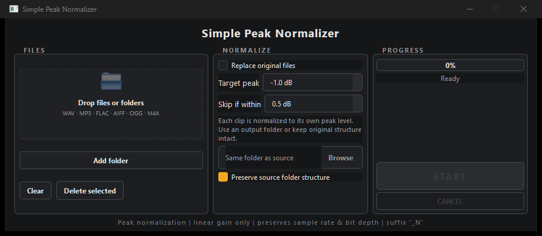

# TRAKKNORMALIZER

> **Batch peak-normalize a sample library so every kick, snare and one-shot hits the same level.** Each clip is matched to its own peak with linear gain — no compression, no pumping.

**[Download for Windows](https://github.com/shardbeats/TRAKKNORMALIZER/releases/latest)** · **[All 6 tools](https://shardbeats.github.io/tools/)** · **[Free beat pack (WAV + stems)](https://shardbeats.github.io/landing/)**

<p align="center"></p>

Free and open source (MIT). Portable exe, no install, no account — your audio never leaves your computer.


Part of the ShardBeats **TRAKK SUITE** (ex `simple-peak-normalizer`).

Batch audio peak normalization tool with a PySide6 GUI. Every clip is normalized to its **own peak level** using linear gain while preserving sample rate and bit depth.

## Features

- Per-file peak normalization (target in dB, 0.0 dB by default).
- Skips clips already within a tolerance of the target (0.5 dB by default).
- Parallel processing (2 threads).
- Drag-and-drop files or folders, or add folders with a button.
- `_N` suffix on processed files (they are never reprocessed).
- Folder structure: recreates the source structure inside the output folder (or in a `<source>_N` folder next to it).
- Replace-original option (only applies when saving next to the source).
- Formats: WAV, MP3, FLAC, AIFF, OGG, M4A.
- Portable: build into a single `.exe` with FFmpeg bundled.

## Requirements

- Windows
- Python 3.x (tested with 3.14)
- FFmpeg on PATH (to run from source). The compiled `.exe` includes it.

## Run from source

### Option A: double-click

Run `start.bat` (creates the virtual environment and installs dependencies on first run).

### Option B: manual

```
python -m venv .venv
.venv\Scripts\python.exe -m pip install -r requirements.txt
.venv\Scripts\python.exe main.py
```

## Usage

1. Drag files or folders into the list (or use **Add folder**).
2. Configure:
   - **Target peak**: target peak level (dB).
   - **Skip if within**: tolerance to skip clips already normalized.
   - **Replace original files**: deletes the original after normalizing (only when saving next to the source).
   - **Browse**: output folder (empty = save next to the source).
   - **Preserve source folder structure**: recreates the source folder structure.
3. Press **START**.
4. Processed files are saved with the `_N` suffix at the output location.

## Build the `.exe`

```
python build_exe.py
```

## Tests

```
pip install -r requirements-dev.txt
python -m pytest tests -q
```

50 tests covering: output-path resolution, codec/bit-depth selection,
file discovery, binary resolution, peak measurement and end-to-end
normalization. The ffmpeg integration tests generate tiny tones on the
fly (no audio fixtures in the repo) and skip gracefully if ffmpeg is
not on PATH.

To regenerate the app icon:

```
python make_icon.py
```

Place `icon.ico` next to `build_exe.py` to have it included in the next build.

## Project structure

```
trakknormalizer/
├── main.py          # Entry point
├── gui.py           # GUI
├── normalizer.py    # Engine: peak analysis, normalization, folder mirroring
├── styles.qss       # Dark theme
├── build_exe.py     # PyInstaller build script
├── requirements.txt
├── start.bat        # Setup + launch
```

## TRAKK SUITE

Six free, offline tools for beatmakers. They are independent: install only what you need.

| Tool | What it does |
|---|---|
| [TRAKKSTUDIO](https://github.com/shardbeats/TRAKKSTUDIO) | Organize, convert and normalize in a single window |
| [TRAKKCONVERTER](https://github.com/shardbeats/TRAKKCONVERTER) | Sample libraries → WAV for the Roland SP-404MK2 |
| **TRAKKNORMALIZER** | Per-clip peak normalization for sample packs |
| [TRAKKNAME](https://github.com/shardbeats/TRAKKNAME) | Beat title generator (EN/ES, 20 moods) |
| [TRAKKOUT](https://github.com/shardbeats/TRAKKOUT) | Beat + artwork → 1080p MP4 for YouTube |
| [TRAKKLICENSE](https://github.com/shardbeats/TRAKKLICENSE) | Beat license contracts as PDF (EN/ES) |

- **Website:** https://shardbeats.github.io/tools/
- **Free beat pack (WAV + stems):** https://shardbeats.github.io/landing/
- **Sound kits:** https://www.beatstars.com/shardbeats/sound-kits

## FAQ

**Is it free?** Yes. MIT licensed, free for personal and commercial use, with no account and no usage limits.

**What is peak normalization, and why per clip?** A conventional normalizer raises everything by the same amount, so one clip that was already loud ends up clipping. This one measures each file and applies just the gain that file needs to reach the target.

**Does it change the sound?** No compression, no limiting — only linear gain. Sample rate and bit depth are preserved.

**Which formats?** WAV, MP3, FLAC, AIFF, OGG and M4A.

**Will it reprocess files?** No. Processed files get an `_N` suffix and are skipped on later runs.

**Does it work offline?** Yes. Nothing is uploaded.

**Which systems?** Windows. The compiled `.exe` bundles FFmpeg.
